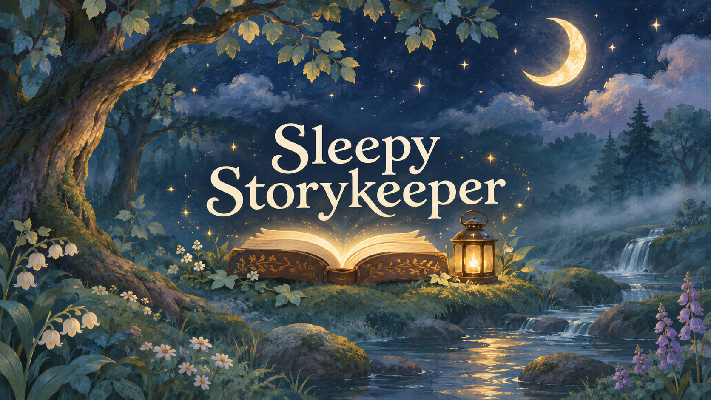

# Sleepy Storykeeper

A modular toolkit for turning a written bedtime story into a narrated ambient video, with prompts for the story, scene artwork, thumbnail, title and description.



## The workflow

```text
Story prompt -> GPT story -> prepared transcript -> local Qwen narration (WAV)
Scene prompt -> generated still -> animated scene loop (MP4)
Narration + scene loop -> final episode (MP4) -> title, description and thumbnail
```

These are separate steps you run and review. There is no single command that generates and publishes an entire episode.

| Module | Purpose | Input -> output | Instructions |
| --- | --- | --- | --- |
| Story / transcript (`story_creator`) | Write a story with your preferred GPT setup, then prepare it for speech | Prompt -> raw text -> prepared text | [Story guide](story_creator/README.md) |
| Voice (`voice`) | Run Qwen3-TTS locally and tune narrator direction | Prepared text + voice profile -> WAV | [Voice guide](voice/README.md) |
| Video creation (`animation`) | Animate a scene image with subtle rain, light and foliage | Still + scene preset -> silent loop | [Video creation guide](animation/README.md) |
| Stitching (`video_assembly`) | Repeat the loop under narration and export the episode | MP4 loop + WAV -> final MP4 | [Assembly guide](video_assembly/README.md) |
| Packaging (`video_packaging`) | Prepare GPT instructions for titles, description and thumbnail concepts | Story + episode facts -> packaging prompt -> reviewed assets | [Packaging guide](video_packaging/README.md) |

## Install and make your first episode

Start with [installation](docs/installation.md), then follow the [complete walkthrough](docs/walkthrough.md). Commands use Windows PowerShell, run from the repository root. Story preparation, animation, packaging and assembly run on CPU. The current full narration runner requires an NVIDIA CUDA GPU and a separate Python environment. GPT writing and image generation are manual steps in your chosen model interface; no GPT API key is required by this workflow.

Your preferred writing setup is **GPT Sol 6.1, Light**. That is a manual model selection preference, not an API model identifier implemented by this project. The optional local Qwen story writer remains available.

## What is included

Source code, reusable prompts, voice profiles, scene presets, sample stories, artwork and small experimental reports. Generated WAV/MP4 files, model weights, downloaded runtimes, environments, caches and secrets are excluded. Download the voice model and regenerate outputs using the guides. Reference-dependent historical voice-cleanup commands need local artifacts that are not included.

The `transcripts/` directory contains older local-writing experiments; new stories start in `story_creator/`. The `scripts/` directory contains compatibility launchers and earlier audio/video studies. The Three.js/Vite preview in `src/` is an optional earlier music-video experiment: see [its original instructions](docs/legacy-music-video.md). It is separate from the bedtime-video pipeline.

## Checks

```powershell
.venv\Scripts\python -m unittest story_creator.test_prepare voice.test_text voice.test_status transcripts.test_text_metrics transcripts.test_pipeline animation.test_layers
npm ci
npm run build
```

Review the narration and final video yourself before publishing. Independent VoiceDesign chunks can change voice identity; a natural-language profile is not a trained custom voice model. Actual runtime comes from the rendered WAV, not a word-count estimate. No uploader, music mixer or caption generator is included.
